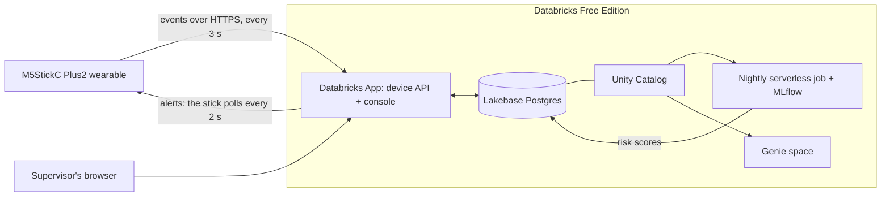

# Worker Safety Wearable on Databricks Free Edition

A $20 wearable detects a fall and alerts a supervisor within a second or two. The supervisor answers from a web console, the worker's stick buzzes, and the worker presses a button to say "I'm OK". Overnight, a model predicts who is most at risk on the next shift, and anyone can ask about it in plain English with Genie.

It all runs on [Databricks Free Edition](https://www.databricks.com/learn/free-edition), with a real device in the loop. There's no IoT hub, no message broker, and no clusters to manage.

## What it does

- **Fall and SOS detection on the device.** An M5StickC Plus2 watches its accelerometer for free fall followed by an impact. Holding the front button sends an SOS.
- **A two-way loop.** The supervisor console shows the incident within a second or two. From the console, the supervisor can acknowledge it, send "Help is coming", tell the worker to evacuate, or send a short message. The stick buzzes and shows the alert, and the worker answers with its buttons.
- **A whole site.** A simulator adds 24 virtual workers to a site map, so the console looks like a real shift. Supervisors can message everyone or evacuate the site in one click.
- **Noise exposure.** The stick's microphone feeds a NIOSH 8-hour noise dose for each worker.
- **A next-shift risk model.** A nightly serverless job copies the day into Delta, builds features for each shift, retrains a model tracked in MLflow, and writes risk scores back for the console.
- **Genie in the console.** Supervisors can ask questions like "Who is most likely to get injured today?" in a side drawer, with the SQL behind every answer.

## Architecture



- **The stick** runs MicroPython (UIFlow2). It signs in as its own service principal using OAuth machine-to-machine, then makes plain HTTPS calls to the App.
- **The Databricks App** (FastAPI) is both the API the stick talks to and the supervisor console. It creates its tables in Lakebase when it starts.
- **Lakebase** (serverless Postgres) holds the live state: worker status, telemetry, incidents, device commands and risk scores.
- **Unity Catalog** registers the Lakebase database as the catalog `worker_safety_lakebase`. Jobs and Genie can then query the live tables with SQL, under the same permissions as everything else.
- **The nightly job** copies Lakebase into Delta history tables in `<catalog>.worker_safety`. It trains the model on 30 days of simulated shifts plus your real ones, registers it as `<catalog>.worker_safety.shift_risk_model`, and writes scores back to Lakebase.
- **Genie** answers questions over the same Lakebase tables. The console embeds it, and it runs as the signed-in supervisor.
- **One Databricks Asset Bundle** (`databricks.yml` plus `resources/`) deploys the App, Lakebase, the catalog registration, the job and the Genie space.

## Repository layout

| Path | What's there |
|---|---|
| `device/` | Stick firmware (`main.py`), a config template, and CA roots for TLS verification |
| `shared/` | Code shared by the stick and the simulators: fall detection, payloads, the offline outbox, noise |
| `app/` | The Databricks App: FastAPI backend and a single-page console (`app/backend/static/index.html`) |
| `jobs/` | The nightly risk job and the model (pandas and scikit-learn, testable on a laptop) |
| `resources/` | Bundle resources: App, Lakebase, nightly job, Genie space, optional stream job |
| `scripts/` | `deploy.sh` (any bundle command, using `config/demo.env`) and `first_deploy.sh` |
| `tools/` | Simulators (`crew.py`, `fake_device.py`), config rendering, reset and probe scripts |
| `sql/` | Unity Catalog setup |
| `stream/` | Optional Zerobus lane for paid workspaces (see the end of this README) |
| `tests/` | Unit tests, plus live tests marked `live` |

## What you need

- **A Databricks Free Edition workspace.** It's free to sign up: https://www.databricks.com/learn/free-edition
- **The [Databricks CLI](https://docs.databricks.com/dev-tools/cli/install.html).** This was tested with v1.17.0; older versions may not know the Lakebase and Genie bundle resources.
- **Python 3.12, [uv](https://docs.astral.sh/uv/) and rsync.** rsync comes with macOS and most Linux distributions.
- **Optional: an M5StickC Plus2,** plus a USB-C cable and a 2.4 GHz Wi-Fi network (a phone hotspot works). Without the hardware, the simulators drive everything, including falls.

## Set up

### 1. Install and sign in

```bash
git clone https://github.com/ramGoli/worker-safety-wearable.git && cd worker-safety-wearable
uv venv --python 3.12 && uv pip install -r requirements-dev.txt
databricks auth login --host https://<your-workspace>.cloud.databricks.com --profile worker-safety
cp config/demo.env.example config/demo.env && chmod 600 config/demo.env
```

### 2. Fill in `config/demo.env`

| Key | Where it comes from |
|---|---|
| `DATABRICKS_PROFILE` | The profile name from `databricks auth login` (`worker-safety` above) |
| `WORKSPACE_HOST` | Your workspace URL, such as `https://dbc-1234abcd-5678.cloud.databricks.com` |
| `WORKSPACE_ID` | The number after `?o=` in your workspace URL, or `uv run python -c "from databricks.sdk import WorkspaceClient as W; print(W(profile='worker-safety').get_workspace_id())"` |
| `DEPLOYER_EMAIL` | The email you sign in with. The App grants this user access to its tables, so the laptop tools can read and reset them. |
| `CATALOG` | `workspace`, Free Edition's default catalog |
| `WAREHOUSE_ID` | The ID of the Serverless Starter Warehouse, from `databricks warehouses list -p worker-safety` |
| `DEVICE_CLIENT_ID`, `DEVICE_CLIENT_SECRET`, `DEVICE_SP_ID` | From step 3 |
| `APP_URL` | From step 5 |

Leave `ZEROBUS_LANE=off` on Free Edition.

### 3. Create the device's service principal

The stick and the simulators sign in as this identity, never as you.

```bash
databricks service-principals create -p worker-safety --json \
  '{"displayName": "worker-safety-device", "entitlements": [{"value": "workspace-access"}]}'
# note "id" (DEVICE_SP_ID) and "applicationId" (DEVICE_CLIENT_ID)
databricks service-principal-secrets-proxy create <DEVICE_SP_ID> -p worker-safety
# note "secret" (DEVICE_CLIENT_SECRET); it's shown only once
```

### 4. Create the Unity Catalog schema

```bash
uv run python tools/run_sql.py sql/01_uc.sql
```

This creates `<catalog>.worker_safety`, which holds the Delta history and the model. It also creates the table and grants for the optional Zerobus lane, which do nothing on Free Edition.

### 5. Deploy

On a new workspace, run the first deploy once:

```bash
scripts/first_deploy.sh
```

Genie won't accept tables that don't exist yet, and the App only creates its tables in Lakebase when it first starts. So the script deploys the bundle without the Genie space, starts the App, and then deploys the whole bundle. Creating the Lakebase project can take a few minutes. To check both stages without deploying anything, run `scripts/first_deploy.sh --validate-only`.

After that, a normal deploy is two commands:

```bash
scripts/deploy.sh deploy
scripts/deploy.sh run console
```

Then finish the setup:
1. Run `scripts/deploy.sh summary` and copy the App's URL into `APP_URL` in `config/demo.env`.
2. Run `uv run python tools/app_probe.py`. Expect `all-apis token ... device-commands=200`.

The console only opens for you at first. To let others use it, grant them **CAN USE** on the App. For the Genie drawer, they also need **CAN RUN** on the Genie space, **SELECT** on the `worker_safety_lakebase.safety` tables, and **CAN USE** on the warehouse.

### 6. Allow Genie to be embedded

The console shows Genie in an iframe, which the workspace blocks by default. A workspace admin (you, on Free Edition) can allow it:
1. Go to **Settings → Security → External access → Embed dashboards**.
2. Choose **Allow approved domains**.
3. Add your App's domain, the host part of `APP_URL`.

The same setting covers dashboards and Genie. The embedded Genie needs third-party cookies, so use Chrome if another browser shows a sign-in loop.

### 7. Try it without hardware

```bash
uv run python tools/crew.py                                   # 24 virtual workers; f = someone falls, q = quit
uv run python tools/fake_device.py --device-id stick-01 --worker "Your Name" --zone "Assembly line"
# f = fall, s = SOS, a = front button (got the alert), b = side button (I'm OK), n = loud noise, q = quit
```

Open `APP_URL`. Within a few seconds the map shows the crew. Press `f` in either terminal, then answer the incident from the console.

### 8. Train the first model

The job runs every night at 2 a.m. (New York time). To get scores right away, run it once after the crew has been running for a few minutes:

```bash
scripts/deploy.sh run nightly_risk
```

The **Next-shift risk** card fills in, and Genie can answer "Who is most likely to get injured today?".

## Flash the stick

1. Install [M5Burner](https://docs.m5stack.com/en/download) and burn **UIFlow2.0 → StickC Plus2** over USB-C. If no serial port appears, install the CH9102 USB driver.
2. Install `mpremote` and check that the motion sensor reads about 1.0 g at rest:
   ```bash
   uv tool install mpremote
   mpremote exec "import M5; from M5 import *; M5.begin(); import math; a=Imu.getAccel(); print(a, math.sqrt(sum(x*x for x in a)))"
   ```
3. Generate the stick's config from `config/demo.env`. The file contains the device's secret, and git ignores it.
   ```bash
   uv run python tools/render_device_config.py --ssid "<2.4 GHz network>" --password "<password>" --worker "Your Name" --verify-tls
   ```
4. Copy the files and run the firmware with its log visible:
   ```bash
   mpremote cp shared/fall.py shared/payload.py shared/outbox.py shared/noise.py device/config.py device/roots.pem :/flash/
   mpremote run device/main.py
   ```
5. To start it on boot, run `mpremote cp device/main.py :/flash/main.py` and choose "run main.py" as the UIFlow2 boot option.

The stick's card turns green in the console within a few seconds.

**Buttons**
- **Front button ("M5"), press:** "got it" for a supervisor alert.
- **Front button, hold 1.5 s:** SOS.
- **Side button farthest from the M5 button, press:** "I'm OK". This clears the fall or SOS on the stick and in the console.
- **Side button closest to the M5 button:** power. Holding it turns the stick off.

To test a fall, drop the stick 50–100 cm onto a cushion.

**Battery:** with Wi-Fi always on, the battery lasts about 1.5–2 hours. Plug the stick into a USB power bank for longer sessions.

## Day to day

- **Clear rehearsal data** (cards, incidents, alerts and sparklines) with `uv run python tools/reset_demo.py`. Risk scores and the Delta history stay.
- **Lakebase scales to zero** when idle, so the first request after a quiet period can take a few seconds.
- **To redeploy after changes,** run `scripts/deploy.sh deploy`, then `scripts/deploy.sh run console`.
- **To rotate the device's secret:**
  ```bash
  databricks service-principal-secrets-proxy list <DEVICE_SP_ID> -p worker-safety
  databricks service-principal-secrets-proxy delete <DEVICE_SP_ID> <SECRET_ID> -p worker-safety
  databricks service-principal-secrets-proxy create <DEVICE_SP_ID> -p worker-safety
  ```
  Put the new secret in `config/demo.env`, re-run `tools/render_device_config.py`, and copy `device/config.py` to the stick.

## Tests

```bash
uv run pytest            # unit tests: device logic, the App's API, the model, the Genie space definition
uv run pytest -m live    # against your workspace and Lakebase (needs config/demo.env and a deployed App)
```

## Security notes

This is a demo, not a certified safety product. Before using it with anyone else's data:

- **Secrets** live only in `config/demo.env` and `device/config.py`, and git ignores both. Never commit them.
- **TLS verification on the stick.** `--verify-tls` makes the stick check the server's certificate against `device/roots.pem`. On UIFlow2 v2.5.3, that check failed with "certificate validity has expired" even though the certificates were valid. If that happens to you, regenerating the config without `--verify-tls` still encrypts the traffic, but the stick no longer checks who it's talking to. Someone on the same Wi-Fi could impersonate the server and capture the device's secret, so use a network you trust and rotate the secret afterwards.
- **The device's identity can call supervisor routes.** The App checks identity on the device routes and on Genie. It doesn't stop the device's service principal from calling the supervisor routes (`/api/state`, `/api/commands` and incident acknowledgement). Treat the device's secret as sensitive as a supervisor login, or add a check in `app/backend/main.py`.
- **Genie runs as whoever is signed in,** so Unity Catalog decides what each person can see.

## Troubleshooting

| Symptom | Fix |
|---|---|
| Deploy fails with "Table 'worker_safety_lakebase.safety…' does not exist" | This is a first deploy. Run `scripts/first_deploy.sh`. |
| Stick stuck on STARTING | The Wi-Fi must be 2.4 GHz with no captive portal. Check the password, and that NTP isn't blocked. |
| Stick logs TLS errors | See "TLS verification on the stick" under Security notes. |
| App returns 403 on `/api/device/...` | Run `tools/app_probe.py`, and check that `DEVICE_CLIENT_ID` matches the service principal's application ID. |
| A card shows offline | The device hasn't sent a heartbeat in 20 s. Check its Wi-Fi and the App's logs in the workspace's Apps page. |
| The Genie drawer is blank or asks you to sign in | Allow embedding (step 6), use Chrome, and check your access to the Genie space. |
| The console doesn't load | Start the App again with `scripts/deploy.sh run console`. |
| Risk card is empty | Run the nightly job once (step 8). |

## Optional: the Zerobus lane (paid workspaces)

On workspaces with Zerobus Ingest, the stick can also write every reading straight into the Delta table `<catalog>.worker_safety.device_events`. A stream job then copies new rows into Lakebase (`resources/stream_job.yml`, `stream/`). To try it:
1. Set `ZEROBUS_LANE=on` and `ZEROBUS_HOST` in `config/demo.env`.
2. Run `tools/smoke_insert.py` to check that inserts work.
3. Start the stream job with `scripts/deploy.sh run stream_to_lakebase_serverless`.

Free Edition doesn't include Zerobus, so it uses the App-only path described above.

## License

MIT. See [LICENSE](LICENSE).
